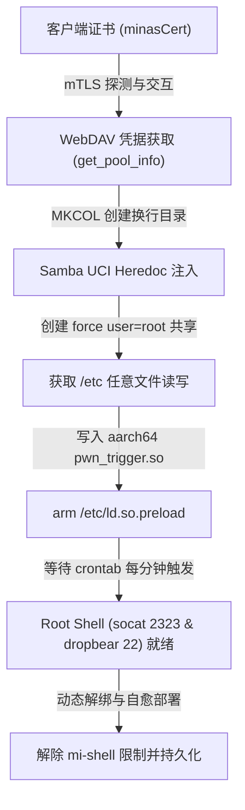
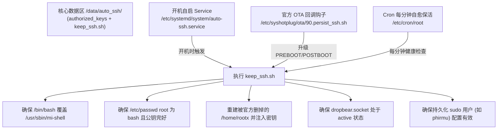

# Xiaomi NAS (RP05) Root, SSH Persistence & System Guide

本技能沉淀了在小米智能存储（RP05，固件版本 1.0.9.x / 1.0.9.462+）上获取 Root 权限、规避官方 OTA 防御、解除受限 Shell、配置系统持久化以及建立非 root 运维 sudo 用户的完整实战经验与操作规程。

---

## 1. 硬件与系统架构全景

- **硬件架构**：Realtek RTD1619B (ARM Cortex-A55 四核 aarch64)，板载 eMMC 存储 + 双 SATA 盘位。
- **操作系统**：Yocto Linux 6.6.x (带有 systemd、uci、OpenWrt 衍生服务)。
- **存储布局**：
  - `/`：EROFS（压缩只读文件系统），包含 `/bin`、`/sbin`、`/usr`、`/lib`、`/root`，原生不可写。
  - `/data`：独立持久化 ext4 分区（约 9.7 GB），**官方 OTA 升级绝对不会格式化或擦除**。
  - `/etc`：基于 OverlayFS 挂载，upper 目录位于 `/data/etc/upper`。
  - `/home`：基于 OverlayFS 挂载，upper 目录位于 `/data/home/upper`。
  - `/nas/pool0`：主机械硬盘联合存储池（CFS FUSE 文件系统，海量空间）。

---

## 2. 核心攻击链原理 (三步获取 Root)



1. **凭据提取**：经由客户端 mTLS 证书与目标 NAS 建立双向认证 TLS 连接，调用 `/cgi-bin/luci/filemgr/get_pool_info` 获取 WebDAV 用户名与口令（默认端口 5000）。
2. **UCI 注入与 SMB 提权共享**：
   - 通过 WebDAV 的 `MKCOL` 方法在存储池上创建一个包含换行符（`\n`）与 UCI 语法的特异目录名。
   - 调用 `/cgi-bin/luci/netshare/add_samba_account`，触发 `smb_mgr.sh` 脚本在解析目录时发生 Heredoc 注入，在 `/etc/config/sambashare` 植入 `set user_force=root` 和 `set create_mask=0644`。
   - 调用 `set_samba_account` 将该共享路径直接修正为 `/etc`，从而获得具有 Root 读写权限的 `/etc` 网络共享。
3. **Preload 触发与动态汇编**：
   - 通过 Python 现场汇编针对 aarch64 架构的微型 ELF 动态库 `pwn_trigger.so`，其 `DT_INIT` 会 fork 执行 `/bin/sh /etc/.rootpwn.sh`。
   - 经 SMB 共享将 `.rootpwn.sh`、`pwn.so` 写入 `/etc`，并布防 `/etc/ld.so.preload`。
   - NAS 系统中 crontab 每分钟执行的定时任务会加载动态库并以 root 身份触发 payload。

---

## 3. 真机踩坑与排障宝典 (Critical Gotchas)

### 踩坑 1：mTLS 握手 Hostname Mismatch (客户端与服务端 UID 不一致)
- **现象**：脚本报错 `no working server CN (tried .0/.00/.1/.2/.20 suffixes)`，SSL 报 `Certificate verify failed: Hostname mismatch`。
- **根因**：原脚本假定客户端证书 UID 与 NAS 服务端设备所有者 UID 相同，直接用客户端 UID 猜测 SNI。但当客户端账号属于家庭成员/共享成员（客户端 UID 如 `2167447919`，角色后缀为 `.2`）时，服务端证书实际上是以设备所有者 UID（如 `2469233489`，CN 为 `nas.2469233489.<did>.0`）签发的。
- **解法**：`Nas.__init__` 初始化时，先以 `check_hostname = False` 发起探测连接，直接读取服务端证书的 `commonName`，然后使用该真实 CN 进行严格的主机名校验；同时将客户端 UID 独立记录。

### 踩坑 2：Samba 修复后共享名变为 `etc-<uid>`
- **现象**：SMB 写入报 `[NtStatus 0xc0000225] No such file or directory`。
- **根因**：原脚本假定共享名始终等于注入的长随机目录名；然而当 `set_samba_account` 将共享路径修正为 `/etc` 时，小米系统根据目录 Basename 重新生成了共享节点，共享名随之变更为 `etc-<uid>`（例如 `etc-2167447919`）。
- **解法**：SMB 写入模块维护候选共享列表 `[f"etc-{uid}", f"{weird_name[:30]}-{uid}", "etc"]`，逐一匹配成功路径。

### 踩坑 3：POSIX 环境下缺乏 `mount.cifs` 与 Root 挂载权限
- **现象**：在 Linux / WSL 环境下执行报 `mount: must be superuser to use mount` 或 `mount.cifs: not found`。
- **根因**：原脚本在 POSIX 下只调用系统命令 `mount -t cifs`。
- **解法**：引入纯 Python 实现的 `smbclient` 模块（基于 `smbprotocol`，支持 SMB2/SMB3），使用正斜杠标准 UNC 路径 `//{ip}/{share}/{file}`，无需任何宿主机 root 权限即可直接读写 NAS。

### 踩坑 4：Dropbear 硬编码 `/usr/sbin/mi-shell` 导致 SSH 命令拦截
- **现象**：SSH 登录后出现 `[MINAS]` 提示符，执行 `echo`、`pwd`、`uname` 等命令无任何反应或报错 `illegal cmd`。
- **根因**：小米在编译 Dropbear 时，硬编码写死了登录 Shell 为 `/usr/sbin/mi-shell`。该受限 Shell 内部自带密码校验和白名单拦截。
- **解法**：
  1. 通过 Root 执行 `mount --bind /bin/bash /usr/sbin/mi-shell`（因根目录 EROFS 只读，利用内核 bind-mount 动态覆盖）；
  2. 修复 `/etc/shells`（补充 `/bin/bash` 和 `/usr/bin/bash`）；
  3. 将 `/etc/passwd` 中 root 的 shell 修正为 `/usr/bin/bash`。

### 踩坑 5：小米官方 OTA 固件升级定点清理 `/home/rootx`
- **现象**：升级固件后 Root 凭据丢失。
- **根因**：在固件升级脚本 `/etc/syshotplug/ota/01.sysclean` 中，官方专门针对开源 root 工具写了清理规则：
  ```sh
  # clean rootx
  [ -d "/home/rootx" ] && rm -rf /home/rootx
  ```
- **解法**：不要只依赖 `/home/rootx`，核心保活文件必须转移至官方 OTA 绝对不动的 `/data/auto_ssh/`，并建立自动重建设施。

---

## 4. 三重自愈持久化体系 (Reboot & OTA Immunity)

为保证无论是常规重启，还是小米官方发布固件 OTA 更新后，SSH 均可免交互自动存活，采用如下分层自愈设计：



### 核心自愈脚本逻辑 (`/data/auto_ssh/keep_ssh.sh`)
```sh
#!/bin/sh
PUBKEY_BACKUP="/data/auto_ssh/authorized_keys"

# 1. 确保有效 Shell 声明
grep -q "^/bin/bash$" /etc/shells 2>/dev/null || echo "/bin/bash" >> /etc/shells
grep -q "^/usr/bin/bash$" /etc/shells 2>/dev/null || echo "/usr/bin/bash" >> /etc/shells

# 2. 修正 root 账户信息
sed -i "s#^root:x:0:0:root:[^:]*:/usr/sbin/mi-shell#root:x:0:0:root:/home/rootx:/usr/bin/bash#" /etc/passwd 2>/dev/null
sed -i "s#^root:x:0:0:root:/root:#root:x:0:0:root:/home/rootx:#" /etc/passwd 2>/dev/null
sed -i "s#:/usr/sbin/mi-shell$#:/usr/bin/bash#" /etc/passwd 2>/dev/null

# 3. 动态 Bind-Mount 覆盖受限 Shell
if ! mountpoint -q /usr/sbin/mi-shell; then
    mount --bind /bin/bash /usr/sbin/mi-shell 2>/dev/null
fi

# 4. 自动重建 rootx 并注入公钥 (抵御 01.sysclean 清理)
mkdir -p /home/rootx/.ssh /etc/dropbear
chmod 700 /home/rootx /home/rootx/.ssh /etc/dropbear
if [ -f "$PUBKEY_BACKUP" ]; then
    while read -r key; do
        [ -n "$key" ] || continue
        grep -q "$key" /home/rootx/.ssh/authorized_keys 2>/dev/null || echo "$key" >> /home/rootx/.ssh/authorized_keys
        grep -q "$key" /etc/dropbear/authorized_keys 2>/dev/null || echo "$key" >> /etc/dropbear/authorized_keys
    done < "$PUBKEY_BACKUP"
    chmod 600 /home/rootx/.ssh/authorized_keys /etc/dropbear/authorized_keys
fi

# 5. 确保 Dropbear 服务处于监听状态
systemctl is-enabled dropbear.socket >/dev/null 2>&1 || systemctl enable dropbear.socket 2>/dev/null
systemctl is-active dropbear.socket >/dev/null 2>&1 || systemctl start dropbear.socket 2>/dev/null
```

---

## 5. 持久化 Sudo 用户创建规范

为了安全运维，建议避免长期直接使用 root 登录，在 `/data` 下创建专用管理账号（如 `phirmu`）：

1. **用户属性**：
   - 主目录：`/data/<username>`（位于持久化分区）
   - Shell：`/bin/bash`
   - UID/GID：分配独立 ID（例如 10372）
2. **Sudo 提权规则**：
   - 规则文件：`/etc/sudoers.d/<username>`
   - 内容：`<username> ALL=(ALL:ALL) NOPASSWD: ALL`
   - 文件权限严格设定为 `0440`，并通过 `visudo -c` 检查语法。
3. **SSH 密钥授权**：
   - 目录：`/data/<username>/.ssh`（权限 `0700`）
   - 文件：`/data/<username>/.ssh/authorized_keys`（权限 `0600`，属主归属目标用户）。
4. **自愈维护**：
   在 `/data/auto_ssh/keep_ssh.sh` 中注册该用户的检查块，一旦固件升级重置了 `/etc/passwd` 或 `/etc/sudoers.d`，保活脚本自动无感还原。

---

## 6. 一键脚本使用参数与操作实例

```bash
# 1. 基础一键 Root 获取 (临时会话，用完自动清理)
python3 xiaomi-nas-root.py 192.168.31.24

# 2. 一键 Root 并部署完整持久化自愈体系
python3 xiaomi-nas-root.py 192.168.31.24 --persist

# 3. 一键 Root、部署持久化自愈，并创建专用 sudo 用户 phirmu
python3 xiaomi-nas-root.py 192.168.31.24 --persist --sudo-user phirmu

# 4. 指定证书目录与 UID (适用于多账号环境)
python3 xiaomi-nas-root.py 192.168.31.24 --cert-dir /mnt/c/Users/Phirmu/AppData/Local/minasCert --uid 2167447919 --persist
```

### 连接验证方式

```bash
# Sudo 用户登录 (推荐)
ssh -i ~/.ssh/id_ed25519_minas phirmu@192.168.31.24

# Root 用户登录
ssh -i ~/.ssh/id_ed25519_minas root@192.168.31.24

# 应急直接连入 Socat Shell (脚本运行期间开放)
nc 192.168.31.24 2323
```
