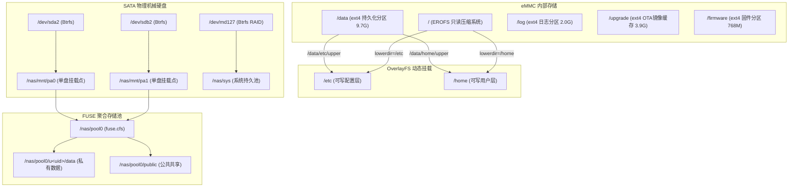

# Xiaomi NAS (RP05) 存储挂载、文件系统架构与用户组运维手册

本技能详细梳理了小米智能存储（RP05，四核 aarch64，Yocto Linux 6.6）的底层文件系统结构、只读与持久化分层挂载机制、CFS 联合存储池、用户与组权限模型，以及在只读限制下运维操作的实战规范。

---

## 1. 分区布局与挂载拓扑全景

小米 NAS 采用 **EROFS 只读压缩底层 + OverlayFS 增量层 + Ext4 核心持久层 + Btrfs 裸盘 + FUSE CFS 联合池** 的多层混合存储架构。



### 1.1 分区与挂载点详细对照表

| 挂载点 | 设备 / 来源 | 文件系统 | 读写属性 | 容量规模 | 说明与生命周期 |
| :--- | :--- | :--- | :--- | :--- | :--- |
| `/` | `/dev/root` | **EROFS** | `ro` (只读) | ~304 MB | 系统核心根目录，高压缩比只读。包含 `/bin`, `/sbin`, `/usr`, `/lib`, `/root`。OTA 升级时整块替换。 |
| `/data` | `/dev/mapper/data_sec` (`/dev/mmcblk0p10`) | **ext4** | `rw` (读写) | ~9.7 GB | **最核心持久化分区**。官方 OTA 升级绝对不擦除。放置自定义脚本、工具、Docker 数据及持久化配置。 |
| `/etc` | `overlay` | **OverlayFS** | `rw` (读写) | 取决于 `/data` | `lowerdir=/etc`, `upperdir=/data/etc/upper`, `workdir=/data/etc/work`。任何写入修改落入 `/data/etc/upper`。 |
| `/home` | `overlay` | **OverlayFS** | `rw` (读写) | 取决于 `/data` | `lowerdir=/home`, `upperdir=/data/home/upper`, `workdir=/data/home/work`。米家 App 映射用户的配置目录。 |
| `/log` | `/dev/mmcblk0p11` | **ext4** | `rw` (读写) | ~2.0 GB | 存放系统日志、服务日志 (`/log/syslog`, `/log/samba`, `/log/nginx` 等)。 |
| `/upgrade`| `/dev/mmcblk0p5` | **ext4** | `rw` (读写) | ~3.9 GB | OTA 固件包下载暂存区 (`minas.bin`)，由固件升级守护进程管理。 |
| `/firmware`| `/dev/mmcblk0p8` | **ext4** | `rw` (读写) | ~768 MB | 设备引导固件与底层模块。 |
| `/nas/mnt/pa0` | `/dev/sda2` | **Btrfs** | `rw` (读写) | 取决于硬盘 (如 3.7T) | 物理 SATA 盘位 0 的真实独立挂载点。 |
| `/nas/mnt/pa1` | `/dev/sdb2` | **Btrfs** | `rw` (读写) | 取决于硬盘 (如 3.7T) | 物理 SATA 盘位 1 的真实独立挂载点。 |
| `/nas/sys` | `/dev/md127` | **Btrfs** | `rw` (读写) | ~20 GB | 跨双盘的软 RAID 阵列，承载系统关键数据库与内部元数据。 |
| `/nas/pool0` | `cfs` (FUSE) | **fuse.cfs** | `rw` (读写) | 硬盘总和 (如 7.3T) | 小米定制集群文件系统 (CFS)。对外聚合两个单盘，提供统一逻辑存储池。 |
| `/tmp`, `/var` | `tmpfs` | **tmpfs** | `rw` (内存盘) | ~1.9 GB | 内存虚拟盘，**重启完全清空**。不可存放任何持久化数据。 |
| `/run`, `/dev/shm`| `tmpfs` | **tmpfs** | `rw` (内存盘) | 760M ~ 1.9G | 进程运行 PID、套接字与共享内存。重启丢失。 |

---

## 2. 只读系统与只读穿透技巧 (Bypass EROFS)

### 2.1 EROFS 的安全限制
由于根目录 `/` 为 EROFS，尝试以下操作会直接报错 `Read-only file system`：
- 直接修改 `/usr/sbin/mi-shell`
- 直接修改 `/sbin/reboot` 或 `/bin/sh`
- 在 `/root` 目录下写入文件 (如 `/root/.ssh/authorized_keys` 原生不可写)

### 2.2 `mount --bind` 内存挂载技术 (神级穿透)
Linux 内核支持使用 `mount --bind` 将可写目录的文件覆盖挂载到只读目录中的特定文件，无需破坏只读文件系统的完整性，也不受 EROFS 限制：

```bash
# 1. 替换只读目录下的受限程序 (例如将 mi-shell 替换为真正的 bash)
mount --bind /bin/bash /usr/sbin/mi-shell

# 2. 检查挂载是否生效
cat /proc/mounts | grep mi-shell
# 输出示例: /bin/bash /usr/sbin/mi-shell ext4 rw,relatime ... (或 ro/rw 视源端而定)

# 3. 取消挂载恢复原状
umount /usr/sbin/mi-shell
```

> [!IMPORTANT]
> `mount --bind` 是纯内存行为，系统重启后会失效。
> 必须将其编入开机脚本（例如 `/data/bin/keep_ssh.sh` 或 systemd 单元），才能实现持久化。

---

## 3. 用户与用户组体系 (User & Group Architecture)

### 3.1 系统内置特权与服务账户

| 用户名 | UID | 主用户组 (GID) | 登录 Shell | 用途与权限特征 |
| :--- | :--- | :--- | :--- | :--- |
| `root` | 0 | `root` (0) | `/bin/bash` | 系统超级管理员。默认 Dropbear 限制登录，官方受限 Shell。 |
| `nassys` | 900 | `nassys` (900) | `/bin/false` | NAS 核心后端服务运行身份 (文件管理器、索引、元数据引擎)。大部分存储池目录属主。 |
| `nasadm` | 901 | `nasadm` (901) | `/bin/false` | NAS 系统配置守护与后台管理。 |
| `naspub` | 902 | `naspub` (902) | `/bin/false` | 公共共享用户 (Samba/WebDAV 公共目录映射)。 |
| `nasguest`| 903 | `nasguest` (903) | `/bin/false` | 访客权限映射。 |

### 3.2 米家 App 用户账户 (`u<uid>`)
- **命名规范**：以 `u` 开头加上小米数字 UID，如 `u2469233489`（所有者账号）、`u2167447919`（家庭共享账号）。
- **UID 范围**：动态分配，通常在 `8000 ~ 11000` 之间。
- **Home 目录**：
  - 系统层：`/home/u<uid>`（基于 OverlayFS，落盘在 `/data/home/upper/u<uid>`）。
  - 存储池层：软链接至 `/nas/pool0/<uid>/data`。
- **Shell 限制**：默认可能被分配到 `/usr/sbin/mi-shell`，需要解除或 bind bash。

### 3.3 自定义管理用户 (如 `phirmu`) 最佳配置规范

由于 `/etc/passwd` 和 `/etc/shadow` 位于 `/etc`（OverlayFS 保护，落盘在 `/data/etc/upper`），添加的新用户**重启后依然存在**。

#### 黄金准则：用户主目录必须放置于 `/data/<username>`
> [!WARNING]
> 不要将非米家用户的家目录放在原生只读根目录或 `/home` 根级下，因为一旦固件升级重构 `/home` overlay，用户数据可能受到影响。最稳妥的位置是 `/data/<username>`（例如 `/data/phirmu`）。

#### 标准建户与 sudo 授权命令：
```bash
# 1. 确保主目录位于 /data 独立分区
mkdir -p /data/phirmu/.ssh
chmod 700 /data/phirmu /data/phirmu/.ssh

# 2. 创建用户并指定家目录与默认 Shell
useradd -d /data/phirmu -s /bin/bash -m phirmu

# 3. 确保 /etc/shells 包含 /bin/bash
grep -qxF "/bin/bash" /etc/shells || echo "/bin/bash" >> /etc/shells

# 4. 配置 SSH 公钥免密登录
cat << 'EOF' > /data/phirmu/.ssh/authorized_keys
ssh-ed25519 AAAAC3NzaC1lZDI1NTE5AAAAIH0n47rP6gY52H7Wf9d2rM/x6Z6q4R7Fz0t+0W2kGgQy phirmu@dev
EOF
chmod 600 /data/phirmu/.ssh/authorized_keys
chown -R phirmu:phirmu /data/phirmu

# 5. 配置无密码 sudo 特权
mkdir -p /etc/sudoers.d
echo "phirmu ALL=(ALL) NOPASSWD: ALL" > /etc/sudoers.d/phirmu
chmod 440 /etc/sudoers.d/phirmu

# 6. 校验 sudoers 语法安全
visudo -c
```

---

## 4. 存储池权限与共享模型 (CFS Permissions Model)

### 4.1 CFS (Cluster File System) 结构
`/nas/pool0` 是基于 FUSE 的逻辑聚合池，物理数据分布在 `/nas/mnt/pa0` 与 `/nas/mnt/pa1` 的 Btrfs 卷中。

```
/nas/pool0/
├── 2469233489/          # 用户 2469233489 的个人根目录
│   └── data/            # 个人私有存储 (对应 App/Samba 私人空间)
├── 2167447919/          # 用户 2167447919 的个人根目录
│   └── data/
├── public/              # 公共共享目录 (对应 App/Samba 公共空间)
│   ├── 电影/
│   ├── 照片共享/
│   └── 软件备份/
└── sys/                 # 系统内部数据池
```

### 4.2 权限与属主规则
- **私有空间**：`/nas/pool0/<uid>/data`
  - 属主：`nassys:u<uid>` 或 `u<uid>:u<uid>`
  - 权限掩码：`0750` 或 `0770`（非所有者无法读取）
- **公共空间**：`/nas/pool0/public`
  - 属主：`nassys:naspub`
  - 权限掩码：`2775` (带有 SGID 位 `g+s`，确保新创建的文件自动继承 `naspub` 组)

### 4.3 运维常用权限修正指令
当通过 root 或第三方工具下载文件到公共空间时，常导致 Samba 无法访问或米家 App 无法索引。使用以下指令重设权限：

```bash
# 修复公共目录属主与继承权限
chown -R nassys:naspub /nas/pool0/public
find /nas/pool0/public -type d -exec chmod 2775 {} +
find /nas/pool0/public -type f -exec chmod 0664 {} +

# 修复某用户私有目录属主
chown -R nassys:u2167447919 /nas/pool0/2167447919/data
find /nas/pool0/2167447919/data -type d -exec chmod 0750 {} +
```

---

## 5. 系统日常巡检与运维命令速查 (Cheat Sheet)

### 5.1 存储与挂载排查
```bash
# 1. 查看所有文件系统的类型与容量分布
df -hT

# 2. 检查哪些目录是可写的 (排除只读和虚拟内存盘)
mount | grep -w "rw" | grep -v "tmpfs"

# 3. 检查 OverlayFS upper 层当前修改过的配置文件
ls -la /data/etc/upper/
ls -la /data/home/upper/

# 4. 检查底层 Btrfs 硬盘健康状态与分配率
btrfs filesystem show
btrfs filesystem df /nas/mnt/pa0
```

### 5.2 用户与特权排查
```bash
# 1. 检查已配置的所有系统及普通用户
getent passwd | grep -v 'nologin\|false'

# 2. 检查 sudoers 规则是否正确加载
sudo -l -U phirmu

# 3. 检查 Dropbear 服务绑定与端口监听
ss -tlpn | grep dropbear
# 或
netstat -tulpn | grep 22
```

### 5.3 开机自启守护检查
```bash
# 检查持久化 SSH 服务的运行状态
systemctl status auto-ssh.service

# 检查定时保活 crontab
crontab -l | grep keep_ssh
```
